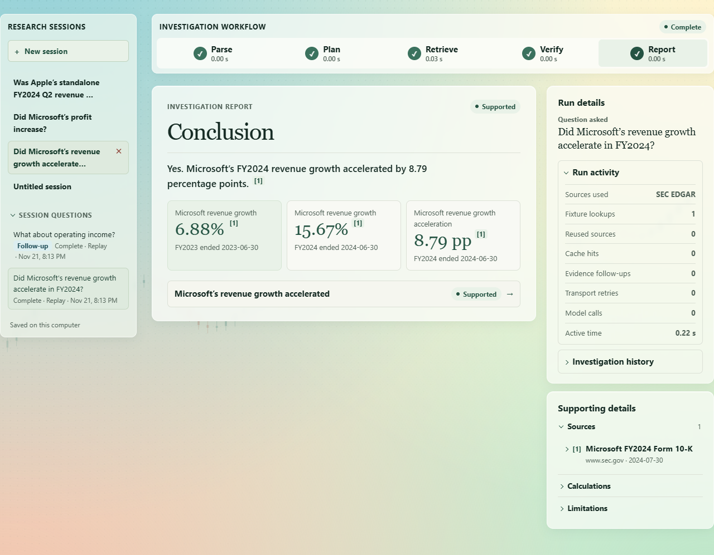
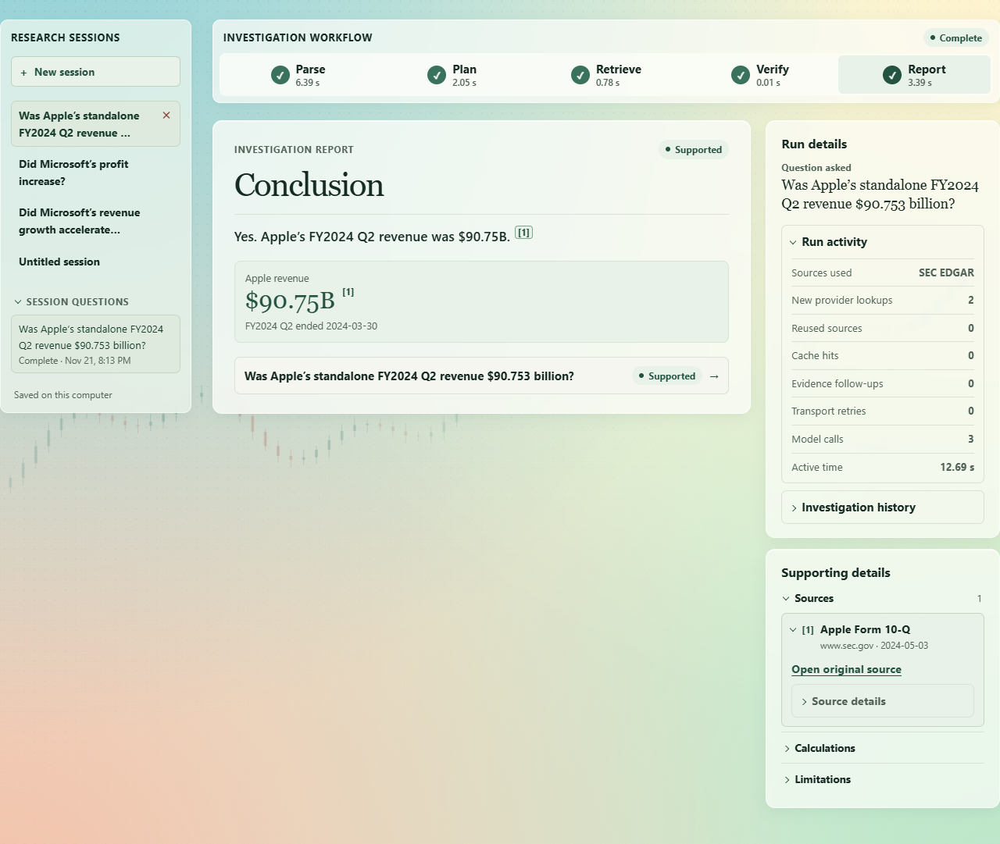

# Evidence-Driven Financial Research Agent

Ask a historical financial question and inspect the figures, verdict, source evidence, and decisions behind the result. The app covers Microsoft, Apple, NVIDIA, Amazon, Alphabet, Meta, Tesla, and Costco. It runs locally with Streamlit, LangGraph, and SQLite.

**Question language:** Use English for questions and follow-ups. Chinese-language support is unavailable.

## Run locally

Use Command Prompt or PowerShell on Windows, or a terminal on macOS or Linux. Install Git if you plan to clone the repository, and install `uv`. Open a new terminal after installation and check that `uv --version` prints a version. [Git installation](https://git-scm.com/install/) · [uv installation](https://docs.astral.sh/uv/getting-started/installation/)

Clone the repository, or download and extract it from GitHub. Run the setup commands from the folder containing `app.py` and `uv.lock`.

```text
git clone https://github.com/ldwj0412/Evidence-Driven-Financial-Research-Agent.git
cd Evidence-Driven-Financial-Research-Agent
```

```text
uv python install 3.12
uv sync --locked
uv run streamlit run app.py
```

Keep the terminal open and visit [the local app](http://127.0.0.1:8501). Allow a few seconds for the first page to load. If Streamlit prints a different local URL, use that address. Press Ctrl+C in the terminal to stop the app.

To check your installation, select **Fixture replay**, choose **Revenue growth**, and click **Run investigation**. The report should show **Supported** and **8.79 pp** of Microsoft revenue growth acceleration. Fixture replay runs without API keys. For live investigations, follow the provider setup below. Saved sessions and pending clarifications are restored on restart.

## Read an investigation

### Fixture replay

The **Revenue growth** example runs without API keys. The report shows the two growth rates, the acceleration, and the source behind the figures.



### Live mode

This investigation checks Apple’s standalone FY2024 Q2 revenue against an SEC filing. Clicking citation **[1]** opens that filing’s entry in **Supporting details**.



See the [illustrated user manual](docs/user-manual.md) for the complete walkthrough, including what to click and how to inspect each stage.

- Select **Parse** to see what the app understood, **Plan** to see what it intends to look up, and **Retrieve** to see the sources it found. Each workflow step shows its elapsed time.
- The **Report** starts with an answer and a verdict. Select a claim to open **How this was verified** in the **Verify** tab. Numbered citations open the corresponding entry in **Supporting details**, which can include SEC filings, FRED observations, and dated articles found through Tavily.
- **Run details** shows the original question and investigation activity. Open **Investigation history** to inspect both passes when verification requested more evidence. Reopening a saved investigation makes zero external calls.
- To try a follow-up, run **Revenue growth**, then select **What about operating income?** in the same session. The second investigation reuses the saved Microsoft filing. A **Follow-up** badge marks questions that carry forward context, and the report lists which details it reused.

## Enable live providers

Put all live provider settings in `config.local.toml`. OpenRouter is the default model provider. Use the links below to get the keys for that setup and enter a real contact email for SEC EDGAR.

| Provider | TOML setting | Purpose | Where to get access |
| --- | --- | --- | --- |
| OpenRouter | `openrouter.api_key` | Parse and plan investigations, identify relevant passages, and run the evaluation baseline. | [Sign in and create an OpenRouter API key](https://openrouter.ai/settings/keys) |
| SEC EDGAR | `sec.user_agent` | Identify your project with a real contact email. | No key required for public data. See [SEC EDGAR API documentation](https://www.sec.gov/search-filings/edgar-application-programming-interfaces). |
| FRED | `fred.api_key` | Retrieve historical and current macroeconomic observations. | [Sign in to your St. Louis Fed account and request a FRED API key](https://fredaccount.stlouisfed.org/apikeys) |
| Tavily | `tavily.api_key` | Search for dated news and retrieve article text. | [Sign in and get a Tavily API key](https://app.tavily.com/home) |

In the folder containing `app.py`, duplicate `config.example.toml` as `config.local.toml`. You can use your file manager. Open the copy in a text editor and fill it in using this example:

```toml
[model]
provider = "openrouter"

[openrouter]
api_key = "replace-with-your-openrouter-key"
base_url = "https://openrouter.ai/api/v1"
model = "openai/gpt-6-luna"

[fred]
api_key = "replace-with-your-fred-key"

[tavily]
api_key = "replace-with-your-tavily-key"

[sec]
user_agent = "NLP Group Research <research@example.com>"
```

Replace the sample keys, project name, and email with your own values. Keep these settings in the Git-ignored `config.local.toml`.

Keep the OpenRouter base URL as shown. The app appends `/chat/completions` when it sends a request.

The example uses GPT-6 Luna, the model used in the live assessment below. The selected model must support strict JSON Schema output.

### Use another OpenAI-compatible endpoint

Set `[model].provider` to `openai_compatible` and fill in the section below with the endpoint's base URL, API key, and model ID. Retain your FRED, Tavily, and SEC settings.

```toml
[model]
provider = "openai_compatible"

[openai_compatible]
api_key = "replace-with-your-provider-key"
base_url = "https://your-provider.example/v1"
model = "replace-with-your-model-id"
token_limit_parameter = "max_completion_tokens"
```

The endpoint must implement `POST /chat/completions` and accept strict `response_format: json_schema` requests. The app appends `/chat/completions` to the base URL. Set `token_limit_parameter = "max_tokens"` if the endpoint uses the older parameter. For a server on the same machine, you can use a loopback URL such as `http://127.0.0.1:8080/v1` and leave the key blank if the server does not require one. Remote endpoints require HTTPS and a key. [Chat Completions API reference](https://developers.openai.com/api/reference/resources/chat/subresources/completions/methods/create)

Start or restart Streamlit after saving the file, then select **Live** in the app. An unconfigured retrieval provider appears in **Provider setup**. Findings from available sources still appear when a provider fails. SEC Company Facts and the SEC filing archive use different endpoints. If the archive rejects access, the run log records the response and affected claims remain unresolved.

A live investigation has a two-minute active budget. Each model request attempt can use up to two minutes, bounded by the remaining investigation time. Time spent waiting for a clarification answer is excluded.

The app binds to loopback and uses one local process per SQLite database. Session data and graph checkpoints live under `.data/`. Class exercises can set `FINANCIAL_RESEARCH_DB` to use a separate SQLite file. The configuration file, database, and checkpoints are ignored by Git.

## Evidence and calculation conventions

- Filing facts use actual fiscal dates. A saved report retains its evidence cutoff, citations, operands, and the ordered run log. A historical as-of date ends at midnight U.S. Eastern time.
- Year-over-year growth compares the same fiscal quarter or a full fiscal year with the prior year. Growth calculated from amounts requires a positive baseline. Acceleration is the difference between growth rates in percentage points. Calculations use unrounded inputs when available and identify comparisons based on rounded disclosures.
- A standalone quarter can use compatible cumulative figures. Diluted EPS requires a directly disclosed quarterly amount. Gross profit is labeled as derived when calculated from consolidated revenue and filed cost of revenue.
- Constant-currency growth comparisons use company-disclosed rates from earnings releases. A source conflict requires comparable periods, scopes, units, and measurement bases. If the evidence cannot establish the comparison or causal relationship, the result is **Unresolved**.
- A session can reuse compatible filing evidence. Latest requests refresh lookups after 15 minutes. Historical FRED lookups use the vintage at the saved cutoff.

## Tests and course assessment

```powershell
uv run pytest
uv run ruff check
uv run ruff format --check
uv run python -m financial_research.evaluate --mode replay --split held_out --output evaluation/replay-results.json
```

For browser acceptance, start Streamlit with a separate database, then run the browser check in another terminal:

```powershell
$env:FINANCIAL_RESEARCH_DB = ".data/browser-check.sqlite3"
uv run streamlit run app.py
```

```powershell
uv run python tests/browser_acceptance.py
```

The browser checks use installed Edge on Windows. Otherwise, install the bundled browser with `uv run playwright install chromium`. Set `RESEARCH_TEST_URL` if the test app uses a different local port.

The [evaluation guide](evaluation/README.md) lists all 30 questions, expected checks, and recorded results. The [assessment catalog](evaluation/cases.json) and [frozen evidence](evaluation/evidence.json) contain the machine-readable cases and sources. Replay uses curated parse and attribution outputs and runs the same graph, retrieval interfaces, calculations, and storage. Record live-model scores separately:

```powershell
uv run python -m financial_research.evaluate --mode frozen --split held_out --output evaluation/model-comparison.json
uv run python -m financial_research.evaluate --mode live-smoke --output evaluation/live-smoke.json
```

The model comparison uses the same configured model for the full workflow and for the baseline. The baseline sees the question, cutoff, and evidence collected by that run. It answers without Python verification. The smoke suite runs six live questions covering the three use cases, clarification, and standalone EPS. For the profit and Apple EPS cases, it submits preset clarification answers when the form offers compatible choices and records the answers used. It also times the operating-income follow-up in the same session.

### Recorded assessment results

| Run | Cases passing every check | Verdicts | Financial values | Citation pairs |
| --- | ---: | ---: | ---: | ---: |
| Final full live run with GPT-6 Luna, November 21, 2026 | 20/20 | 24/24 | 14/14 | 38/38 |
| Full held-out fixture replay after the fixes | 20/20 | 24/24 | 14/14 | 38/38 |

The full live run passed **5/5** conflict cases and **3/3** clarification or uncertainty cases, with **zero unsupported numerical assertions**. The Python test suite passed 70 tests.
