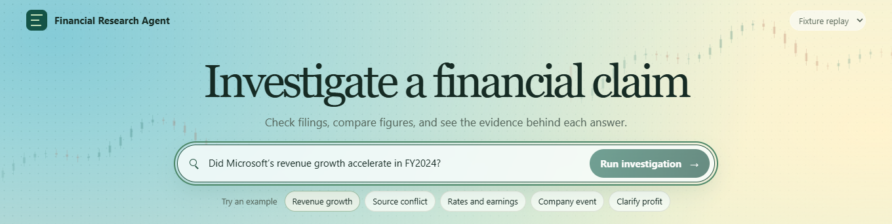
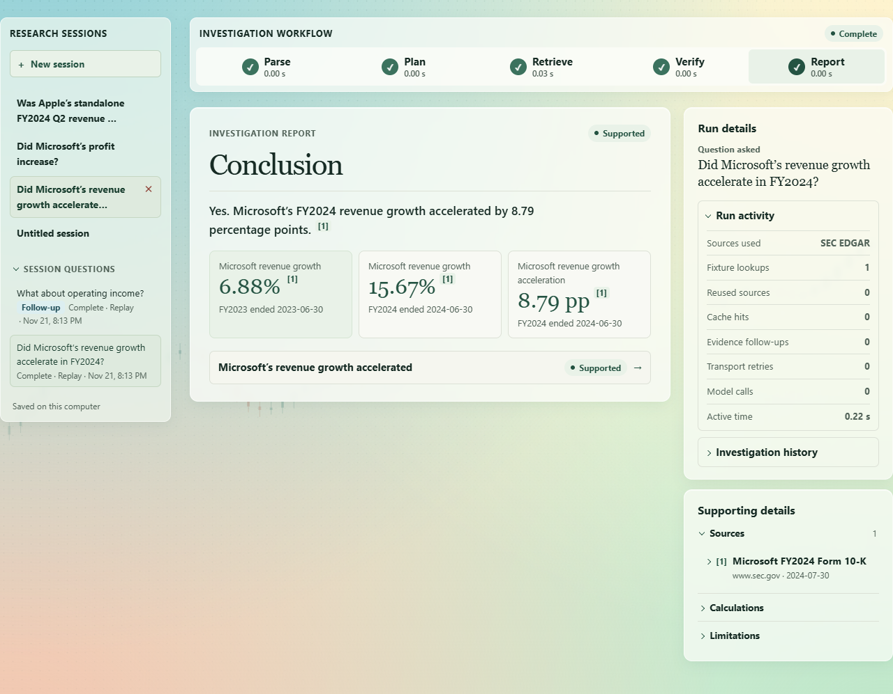
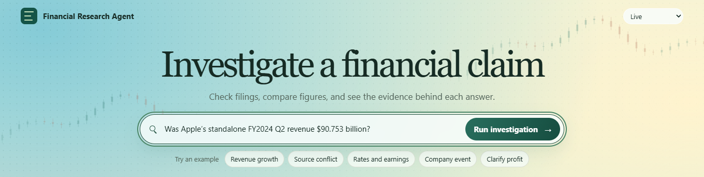
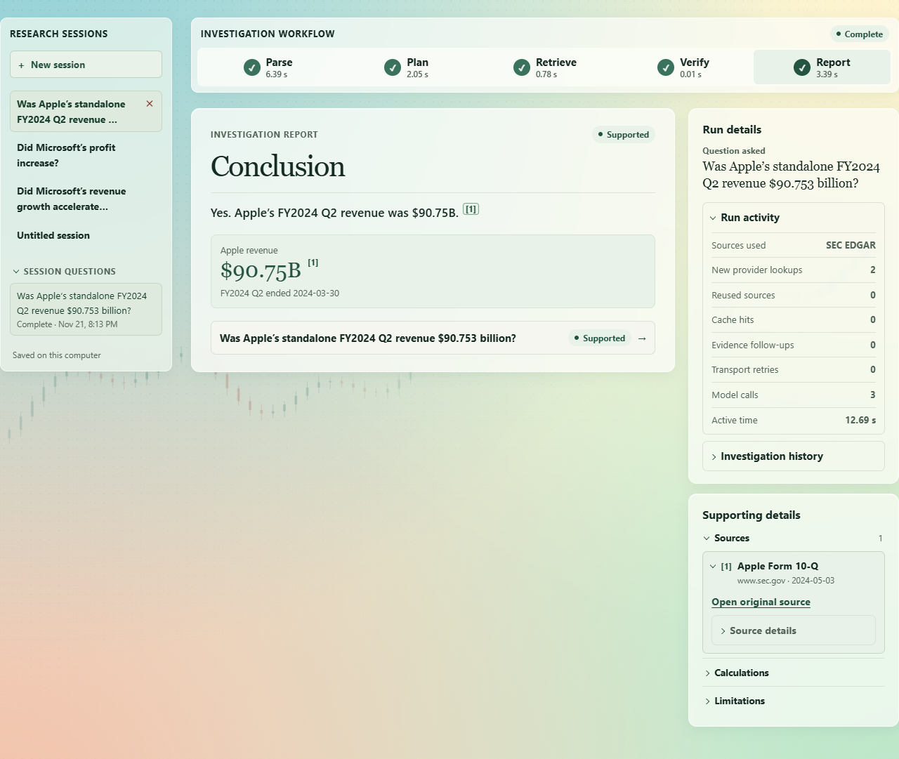
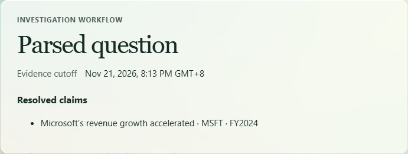
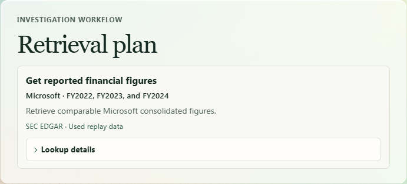
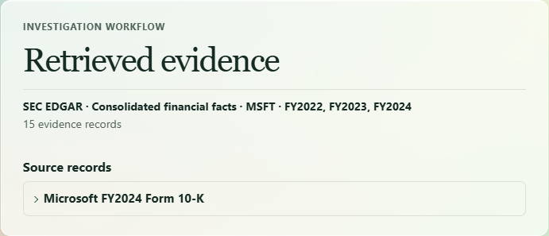
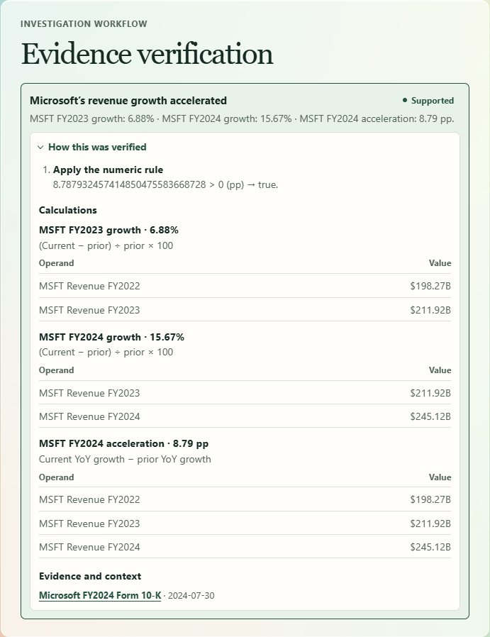
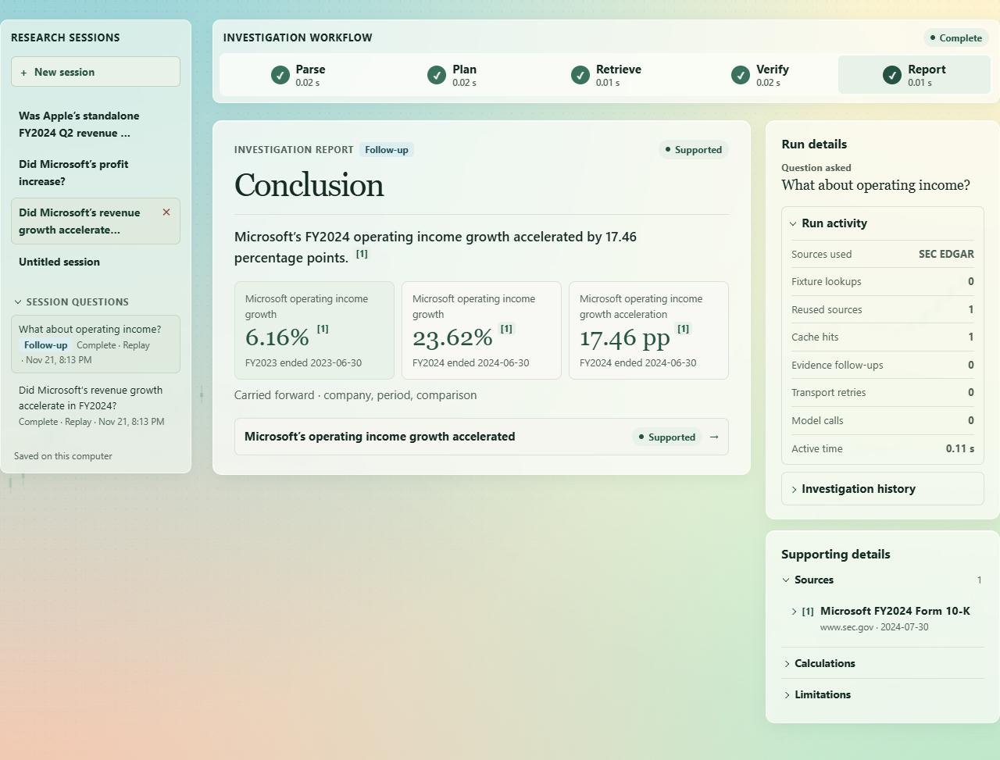
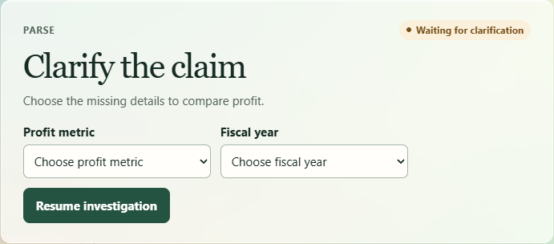

# Financial Research Agent user manual

Use this guide to run an investigation, check the sources behind the answer, and continue a saved question. The screenshots show the desktop layout. On a narrow screen, use **Show sessions** to open the sidebar.

- [Start the app](#1-start-the-app)
- [Try Fixture replay](#2-try-fixture-replay)
- [Run a Live investigation](#3-run-a-live-investigation)
- [Read the workflow and report](#4-read-the-workflow-and-report)
- [Ask a follow-up or answer a clarification](#5-ask-a-follow-up-or-answer-a-clarification)
- [Review saved investigations](#6-review-saved-investigations)

## 1. Start the app

Follow [Run locally](../README.md#run-locally) to install Python 3.12 and the pinned packages with `uv`. In the folder containing `app.py`, run:

```text
uv run streamlit run app.py
```

Keep the terminal open and visit the URL Streamlit prints, usually [http://127.0.0.1:8501](http://127.0.0.1:8501).

Use the language selector to switch between **English** and **简体中文**. The browser remembers your selection. The language of your question determines the language of the answer, and changing the interface language leaves saved answers in their original language.

| Mode | What the app uses | When to choose it |
| --- | --- | --- |
| **Fixture replay** | Bundled evidence and prepared model inputs for the examples. The app runs the calculations, verification, reporting, and session storage locally. | Learn the interface, demonstrate the workflow, or test without API keys. |
| **Live** | The configured OpenRouter or OpenAI-compatible model interprets the question and plans lookups. Depending on the question, the app retrieves evidence from SEC EDGAR, FRED, or Tavily. | Investigate a new question and see what the available sources support. |

## 2. Try Fixture replay

1. Select **Fixture replay** in the upper-right **Research mode** dropdown.
2. Click **New session** if you want a fresh question history.
3. Click **Revenue growth** under **Try an example**. The example fills the question box.
4. Click **Run investigation**.



The example asks whether Microsoft’s FY2024 revenue growth accelerated. The completed report should show **Supported**, with **6.88%** growth in FY2023, **15.67%** in FY2024, and an acceleration of **8.79 percentage points**. The calculation uses the underlying revenue figures and rounds the displayed results.



Other examples include **Source conflict**, **Rates and earnings**, **Company event**, and **Clarify profit**. Use the example buttons or the suggested follow-up to stay within the bundled cases. Switch to **Live** for a new question.

## 3. Run a Live investigation

Ask questions or follow-ups in English or Chinese. For example, enter **苹果 2024 财年第二季度单季营收是 907.53 亿美元吗？** to verify the same claim as the English example below.

1. Open **Connection settings** (**连接设置**) and choose **Model settings** (**模型设置**). An OpenRouter-issued key goes under **OpenRouter**. A company gateway uses its own base URL, model ID, and key under **OpenAI-compatible** (**OpenAI 兼容接口**). It must support Chat Completions with strict JSON Schema output. Click **Save settings** (**保存设置**).
2. Under **Data source settings** (**数据源设置**), enter an English project name and contact email for SEC filings. Add a FRED key for macroeconomic observations and a Tavily key for news if your question needs those sources. Save the settings and select **Live** from **Research mode**. Changes apply to the next submission in the current browser session. Use `config.local.toml` for persistent defaults. [Provider setup guide](../README.md#enable-live-providers)
3. Click **New session** and enter a question. Specify the company, metric, and fiscal period for a precise check. For example:

   > Was Apple’s standalone FY2024 Q2 revenue $90.753 billion?

4. Click **Run investigation**. Watch the status and elapsed time as the app moves through the workflow. A clarification prompt pauses the run until you respond.



The Apple example checks the standalone quarter against SEC evidence. The report rounds the headline figure, while the **Verify** tab and **Calculations** under **Supporting details** let you inspect the recorded check and operands. Click a numbered citation to expand its source, then use **Open original source** to view the filing.



If **Live** shows **Provider setup**, open **Connection settings** and update the affected model or data source. If a run stops or returns **Unresolved**, open the affected workflow tab and **Run details → Investigation history** to see which lookups failed. The app can retain findings it verified before a lookup failed. The active run budget is two minutes. Time waiting for a clarification answer is excluded.

## 4. Read the workflow and report

### Parse

**Parse** shows the question the app understood, the evidence cutoff, and the **Resolved claims**. Here, resolved means the app has identified what to investigate. Each claim gets a verdict later, in **Verify**. For a multi-part question, check that the list includes each part you meant to ask.



### Plan and Retrieve

**Plan** lists the intended lookups, including the company, periods, and purpose. When verification requests more evidence, use **Initial plan** and **Follow-up plan** to see both passes.



**Retrieve** shows the lookup outcomes and **Source records**. A **News search** entry shows that the app attempted a Tavily search. The report lists sources under **Supporting details** when they contribute to a finding, calculation, or timeline entry. A search result can be retrieved and still be absent from the report.



### Verify and Report

In **Verify**, expand **How this was verified** under a claim. This shows the available checks, evidence links, calculations, or reasons the evidence was insufficient. You can also jump here by clicking the matching claim row in the report.



**Report** starts with the answer. Read the verdict alongside its claim. **Supported** means the evidence satisfies the check. **Contradicted** means the evidence goes against the stated claim. **Unresolved** means the evidence is insufficient. The overall report can show **Partially supported** when some claims are supported and others remain unresolved. **Complete** above the workflow means the run finished.

For **Source conflict**, the claim being checked is that the two figures conflict. A **Contradicted** verdict means that the evidence shows why both figures can be valid, such as one being as reported and the other in constant currency.

Use **Supporting details** to expand sources, calculations, and limitations. In **Run details**, **New provider lookups** counts fresh retrieval work across providers in Live mode. **Sources used** shows the providers whose evidence contributed to the report. A run can make several lookups even if the final report cites only one provider.

## 5. Ask a follow-up or answer a clarification

### Continue a question

1. Finish the **Revenue growth** example and keep that report selected.
2. Click **What about operating income?** under **Continue this report**, then click **Run investigation**.
3. Look for **Follow-up** above the conclusion and beside the entry in **Session questions**. The report’s **Carried forward** line lists the context it reused.

In this example, the app investigates operating income for the same company and comparison. The fixture result is **17.46 percentage points** of acceleration. **Run activity** shows that it reused the source.



In Live mode, you can type your own follow-up with the previous report selected. Include any details you want to change, such as a different fiscal year or metric.

### Resume a clarification

To try the form, click **Clarify profit**, then **Run investigation**. Choose **Operating income** and **FY2024**, then click **Resume investigation**. The app continues the same question and saves the answer with its history.



## 6. Review saved investigations

- Select a research session, then choose a question under **Session questions**. The list starts with the newest question. Reopening a saved report makes zero external calls.
- Open **Investigation history** in **Run details** to inspect stage outcomes. The workflow shows the time spent in each stage, and the run details show total active time.
- To start an independent investigation, choose **New session**. To remove a session, select it, click the **×**, and read the confirmation before deleting it. Deleting the session removes its investigations.
